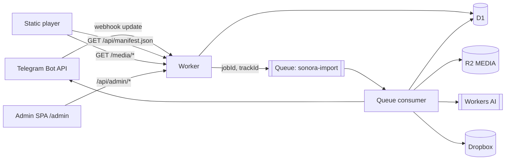

# Architecture

Describes what the code in this repository actually does. Anything marked
*best-effort* is exactly that — it is not a guarantee.

## 1. Component map

| Component | Responsibility | Location |
|---|---|---|
| Player | Static catalog UI, playback, EQ, ID3 fallback | `index.html`, `js/`, `css/` |
| Worker | HTTP API, Telegram intake, queue consumer, cron, media delivery | `cloud/worker/src/index.js` |
| D1 | Authoritative catalog, jobs, storage records, admin/auth rows | `cloud/worker/migrations/0001_init.sql` |
| Queues | At-least-once async import/cleanup delivery + DLQ | `wrangler.jsonc` |
| R2 (`MEDIA`) | Public playback copies and cover art | `src/services/storage.js` |
| Dropbox | Archived originals, multi-account | `src/services/dropbox.js` |
| Workers AI (`AI`) | Whisper transcription, Qwen text cleanup, metadata completion | `src/services/transcribe.js`, `lyrics.js`, `metadata.js` |
| Admin SPA | Operator UI, same origin as the API | `cloud/worker/public/admin/` |
| GitHub Pages | Static player hosting | `.github/workflows/` |



## 2. Root website ↔ Worker

The player is build-free. `index.html` sets `window.SONORA_API` (empty by
default). `loadManifest()` in `js/app.js`:

1. If `SONORA_API` is set, `GET ${SONORA_API}/api/manifest.json`.
2. If remote is empty or fails, `GET audio/manifest.json` (static, empty).
3. Non-empty results are merged into `ARTISTS`/`ALBUMS` via
   `mergeManifestTrack()`, which derives stable slugs from artist/album names.

`GET /api/manifest.json` selects only `status='ready' AND deleted_at IS NULL AND
audio_key IS NOT NULL`, ordered by `ready_at DESC`, capped at 2000 rows.
`file` and `cover` are absolute URLs built from `MEDIA_BASE_URL` (fallback
`/media`). Requests get CORS headers only when the `Origin` is in
`ALLOWED_ORIGINS`.

Audio and covers are served by `GET|HEAD /media/<key>` from R2 with
`accept-ranges: bytes`. Range parsing supports `bytes=a-b`, `bytes=a-`,
`bytes=-n`; unsatisfiable ranges return `416` with `content-range: bytes */<size>`.
Successful ranges return `206`. `..` in the key is rejected with `400`.

## 3. Admin hosting and authenticated API

`wrangler.jsonc` declares `assets.directory = "./public"`, so the Worker serves
the admin SPA at the same origin (`/admin/`), which keeps the session cookie
first-party. This is the authoritative asset path; do not add a second copy.

`index.js` applies `ALLOWED_ORIGINS` to every `/api/admin/*` request and adds CORS
headers only for allowlisted origins. `routes/admin.js` then, in order:

1. `POST /api/admin/bootstrap` — one-time, requires `ADMIN_BOOTSTRAP_TOKEN`,
   refuses if any admin exists.
2. `POST /api/admin/login` — origin check, PBKDF2 verify, rate limit, session.
3. `POST /api/admin/logout`, `GET /api/admin/me` — session operations.
4. Everything else — `requireAdmin(db, request, { mutating })`. Mutations also
   require a matching CSRF header/cookie pair and an allowlisted origin.

Session mechanics (`src/lib/auth.js`, `src/lib/crypto.js`):

- Password: PBKDF2-SHA256, 100 000 iterations (Workers' practical ceiling), 16-byte
  random salt per user; per-row iteration count stored for future upgrades.
- Session token: 32 random bytes, base64url-ish, stored as SHA-256 hex in
  `sessions.token_hash`. Cookie `sonora_session`, `HttpOnly; Secure; SameSite=None`,
  12 h TTL, revocable.
- CSRF: separate random token in a readable `sonora_csrf` cookie, hashed into
  `sessions.csrf_hash`; mutating requests must send `x-csrf-token` equal to the
  cookie and matching the hash.
- Login throttling: 10 `login_failed` audit rows per IP within 15 min → `429`.
- Roles: `admins.role` ∈ `admin|viewer`; `requireAdmin` rejects non-admin roles,
  so `viewer` accounts can authenticate but cannot pass the guard.

Admin routes (all under `/api/admin/`): `dashboard`, `tracks` (list/get/patch/
delete/retry), `tracks/:id/lyrics` (PUT, manual override), `sources` (+
`PATCH enabled`, `POST check`), `dropbox/accounts` (+ toggle/disconnect/check,
`POST dropbox/connect`, `GET dropbox/callback`), `errors` (+ dead letters),
`telegram/test`, `telegram/webhook` (register), `health`.

## 4. Telegram intake

`POST /api/telegram/webhook` in `src/routes/telegram.js`:

1. Compare `x-telegram-bot-api-secret-token` to `TELEGRAM_WEBHOOK_SECRET`
   (length-checked, byte comparison). Mismatch → `401`.
2. Reject malformed JSON or a missing numeric `update_id`.
3. `INSERT OR IGNORE INTO telegram_updates` — `update_id` is the PK, so a replay
   returns `{ ok: true, duplicate: true }` and does no work.
4. `extractAudio()` accepts `message` or `channel_post`, and
   `audio | document | voice`. Documents must have an `audio/*` or
   `application/octet-stream` MIME type.
5. Rejections happen before enqueue and are recorded idempotently as a `failed`
   track row:
   - `file_too_large` — `file_size` > 20 MB (`MAX_IMPORT_BYTES`, matches the Bot
     API download cap).
   - `preview_too_short` — `duration <= PREVIEW_MAX_SECONDS` (default 30 s).
6. Upsert `sources` by `chat_id` (`channel` or `group`).
7. `UPDATE sources SET last_sequence = last_sequence + 1 ... RETURNING` — the
   durable per-source order. The value is stored on the new `tracks` row.
8. Insert `tracks` (`status='pending'`, `source_metadata` JSON with file id,
   filename, MIME, caption, duration), create a `jobs` row, and
   `IMPORT_QUEUE.send({ jobId, trackId })`.

If `send` fails, the update is still acknowledged and the `queued` job row
survives; the cron re-enqueues it. Queue payloads never contain audio.

`registerWebhook(env, workerUrl)` validates the secret length (16+) and an
`https://` URL, then calls `setWebhook` with `allowed_updates:
["message","channel_post"]`.

## 5. Queue processing and ordering

`queue(batch, env)` in `src/index.js`, for each message:

1. `claimJob(db, jobId)` — a single guarded `UPDATE ... WHERE status IN
   ('queued','failed') AND (lease_until IS NULL OR lease_until < now)` that sets
   `status='running'`, increments `attempts`, and returns the row. No row means
   already done/leased/dead → `ack()`.
2. Dispatch: `import` → `importTrack`; `cleanup`/`repair` → `cleanupTrack`.
3. `result.ok === false && result.failures` → `failJob(..., 60)` then
   `retry({ delaySeconds: 60 })`, or `ack` when the job went `dead`.
4. Success → `finishJob` (`succeeded`) and `ack()`.
5. Thrown error → `failJob(..., 30)`; `retry` unless dead.

`failJob` moves the row to `dead` when `attempts >= max_attempts` (default 5) and
clears `next_attempt_at`. `dead` jobs are listed in the admin Errors view and are
retried by hand via `POST /api/admin/tracks/:id/retry`.

**Ordering is not provided by Queues.** It comes from
`UNIQUE (source_id, source_sequence)` and the atomic counter. Different sources
are deliberately not serialized; there is no cross-source ordering guarantee.

`scheduled()` runs every 15 minutes (`triggers.crons`):

- re-enqueues up to 20 `queued|failed` jobs whose lease is absent or expired for
  more than 10 minutes;
- calls `cleanupTrack` for up to 10 tracks stuck in `deleting`.

## 6. D1 entities and state transitions

`migrations/0001_init.sql` (only migration so far):

| Table | Purpose / keys |
|---|---|
| `admins` | Admin accounts; `username` UNIQUE; PBKDF2 hash + salt + iterations; `role`, `disabled` |
| `sessions` | `token_hash` UNIQUE, `csrf_hash`, `expires_at`, `revoked_at` |
| `sources` | Telegram chats; `chat_id` UNIQUE; `last_sequence` ordering counter; `access_status/access_error`; `enabled` (stored, not enforced) |
| `telegram_updates` | `update_id` PK — webhook dedupe |
| `tracks` | Catalog rows; status machine; `UNIQUE (source_id, source_sequence)`, `UNIQUE (telegram_chat_id, telegram_message_id)` |
| `track_storage` | One row per `(track_id, provider, object_key)` with `state`; PK is that triple |
| `jobs` | Durable queue of work; `type ∈ import|transcribe|cleanup|repair`; `status ∈ queued|running|succeeded|failed|dead`; lease + attempts |
| `lyrics` | PK `track_id`; `source`, `format`, `status`, `text`, `segments` (JSON), `raw_transcript`, `model`, `manual_override` |
| `dropbox_accounts` | Refresh token ciphertext+IV, cached access token, health, quota, folder |
| `oauth_states` | Single-use Dropbox OAuth state, 10 min TTL |
| `audit_log` | Admin and login events; also the login rate-limit source |
| `error_log` | Categorized failures for the admin Errors view |
| `settings` | Unused |

Track status:

```text
pending ──import──> processing ──┬─> ready          (published)
                                 ├─> needs_review   (incomplete; not published)
                                 └─> failed         (rejected / fatal)
ready ──DELETE──> deleting ──cleanup──> deleted
failed/needs_review ──retry──> pending
```

`processing` is set at the top of `importTrack`. Terminal `ready`/`deleted` /
`deleting` tracks short-circuit a repeat import (`skipped`).

`track_storage.state`:

```text
pending -> uploading -> stored
                     \-> failed      (recorded, retried by re-running the stage)
stored -> deleted                    (during cleanup)
```

`beginOperation` is an upsert that keeps `stored` sticky. `completeOperation`
and `failOperation` are plain updates. There is no cross-provider transaction;
consistency is per-row plus the publish gate.

## 7. Import pipeline (`src/jobs/import.js`)

Ordered stages, each durable so a retry only redoes unfinished work:

1. **Load track.** Missing → non-retryable `ImportError`.
2. **Download** via `telegram.getFile` + `downloadFile`. Bot API 20 MB cap is
   enforced twice (declared size and actual byte length). Failures are written to
   `error_log`; `file_too_large` is terminal, other failures leave `pending`.
3. **Duration.** `source.durationSeconds` (Telegram's own metadata) → local probe
   → `NULL`. `probeDuration` parses MP3 frames (ID3v2 offset + MPEG header walk)
   and FLAC STREAMINFO. M4A/OGG/AAC return `null` — never guessed. At or below the
   preview threshold the track becomes `failed` with `preview_too_short`.
4. **Metadata.** `resolveMetadata` precedence: manual → ID3 tag → Telegram
   (title/performer) → filename. Then `completeMetadataWithAi` fills **only**
   missing fields; years must be integers in `[1900, currentYear]`. Model output
   that fails validation is dropped, not guessed.
5. **R2 audio.** Key `audio/<trackId>.<ext>`, content type from extension
   (`audio/mpeg`, `audio/flac`, otherwise `audio/ogg`). Recorded in
   `track_storage` before and after the put.
6. **R2 cover.** Optional. `covers/<trackId>.<png|webp|jpg>` from ID3 APIC. A
   cover failure is logged and does not block audio.
7. **Dropbox archive.** `pickAccount` chooses the enabled account with
   `health ∈ (healthy, unverified)` and enough quota (1 MB headroom), smallest
   `quota_used` first. Upload path `<folder>/originals/<trackId>.<ext>`, mode
   overwrite. Failure is logged, the account is health-checked, and the track is
   still publishable (Dropbox is not in the publish gate).
8. **Lyrics** — see §9.
9. **Publish.** `canPublish = allStored(db, id, ['r2']) && title && artist &&
   duration != null`. Status is `ready` (with `ready_at`) or `needs_review` (with
   an `incomplete: ...` reason). `cover_key`, `audio_key`, and Dropbox fields are
   written in the same update.

## 8. Deletion and recovery

`DELETE /api/admin/tracks/:id` requires `x-confirm-delete` equal to the track id.
`markDeleted` sets `status='deleting'`, `deleted_at`, guarded by
`status != 'deleted'`, so the manifest drops the track before any provider call.
A `cleanup` job is enqueued; if enqueue fails, cleanup runs inline.

`cleanupTrack` is idempotent:

- R2 audio: delete, mark the `track_storage` row `deleted`.
- R2 cover: `deleteR2IfUnreferenced` counts other non-deleted tracks with the
  same `cover_key`; shared artwork is preserved.
- Dropbox: delete `<dropbox_path>` on the recorded account; HTTP `409` means
  already gone and is treated as success.
- Any failure → status stays `deleting` with `cleanup_failed: ...`, and both the
  cron and the admin Retry re-attempt.
- All succeeded → `status='deleted'`, `error=NULL`. The row is retained.

## 9. Lyrics and transcription

`resolveLyrics` in `import.js`, in priority order:

1. **Embedded SYLT** → `source='embedded'`, `format='line'`, timings from the tag.
   Whisper is not called.
2. **Embedded USLT** → `source='embedded'`, `format='plain'`, `segments=NULL`.
   Explicitly not synchronized; the player must not treat it as timed.
3. **Transcription** unless `TRANSCRIBE_ON_IMPORT === 'false'`.
4. **Neither** → no lyrics row.

Transcription providers (`src/services/transcribe.js`):

- `workersAiTranscriber` — default, model `CF_WHISPER_MODEL`
  (`@cf/openai/whisper-large-v3-turbo`), payload `{ audio: [...bytes], task:
  'transcribe', language? }`.
- `groqTranscriber` — only when `TRANSCRIPTION_PROVIDER === 'groq'` **and**
  `GROQ_API_KEY` is set. Enforces a 25 MB upload cap. A Groq failure never falls
  back silently; the lyrics row records the failure.
- `normalizeTranscription` unifies both shapes to `{ text, segments[] }` with
  `id: 'seg-<i>'`, drops empty/invalid segments, and throws when nothing usable
  remains.

Cleanup (`src/services/lyrics.js` + `ai.js`):

- System prompt forbids translation, added/dropped verses, and segment splitting;
  requests JSON `{ segments: [{ id, text }] }`.
- `mergeCleanup` merges corrected text onto the **original** timings by id,
  ignores unknown ids, and rejects the whole result when: the JSON is invalid,
  no segment text survives, would erase all lyrics, or fewer than
  `ceil(n/2)` segments came back (guards against paraphrase/truncation).
- Rejected cleanup keeps the raw transcription and sets `status='needs_review'`.
- Stored `segments` are always line-level (`{id,start,end,text}`); word timings
  are dropped after text correction.
- `raw_transcript` is preserved for `source='generated'`.
- `saveLyrics` upsert is guarded by `WHERE lyrics.manual_override = 0`, so an
  admin edit (`PUT /api/admin/tracks/:id/lyrics` sets `manual_override=1`) is
  never overwritten by automation.

`GET /api/tracks/:id/lyrics` only returns rows whose track is `ready` and not
deleted.

## 10. Dropbox storage

- OAuth: `authorizeUrl` requests `token_access_type=offline`; state is a UUID in
  `oauth_states` bound to the admin, 10 minutes, deleted on first use.
  `handleDropboxCallback` exchanges the code with
  `${PUBLIC_WORKER_URL}/api/admin/dropbox/callback` as the redirect URI.
- Refresh tokens are AES-GCM encrypted with a key derived from
  `TOKEN_ENCRYPTION_KEY` (SHA-256 → AES-GCM 256, random 12-byte IV). Ciphertext
  and IV are stored in separate columns.
- Access tokens are cached in D1 with `access_expires_at`; refresh happens when
  fewer than 60 s remain.
- `pickAccount` selection is quota-aware but uses **stored** quota values, so it
  is only as fresh as the last `checkAccount` run.
- Disconnect sets `enabled=0`, overwrites the ciphertext with the literal
  `revoked`, clears the access token, and marks health `revoked`.
- Uploads use `mode: overwrite`, `autorename: false`, so a retried import writes
  the same path and is idempotent.

## 11. Diagnostics

`GET /api/health` (public, CORS, no auth) returns
`{ environment: 'deployed-worker', checked_at, groq_enabled,
transcription_provider, checks[] }`. Each check is `{ name, ok, detail|error,
checked_at }`:

| Check | What it proves |
|---|---|
| `d1` | `SELECT COUNT(*) FROM tracks` succeeds |
| `telegram` | `getMe` + `getWebhookInfo` from the Worker (real outbound call) |
| `workers_ai` | round-trip on `CLEANUP_MODEL` |
| `r2` | put → get → delete of a `_health/<ts>.txt` probe |
| `queues` | binding present + job counts |
| `dropbox` | stored account health rows (does **not** call Dropbox) |

No tokens are returned; a test asserts the bot token and Groq key never appear in
the response. `GET /api/admin/health` returns the same report on the admin origin.

## 12. API boundaries

- Browser → Worker: `/api/manifest.json`, `/api/tracks/:id/lyrics`, `/media/*`.
- Telegram → Worker: `/api/telegram/webhook` (secret header).
- Admin SPA → Worker: `/api/admin/*` (session cookie + CSRF + origin allowlist).
- Worker → providers: Telegram Bot API, Dropbox API, Workers AI, optional Groq.
- No provider call is ever made by the static site or from a local build.

Best-effort areas (do not describe as guarantees): metadata AI completion, lyric
cleanup quality, Dropbox availability, quota freshness, Telegram delivery order
(only per-source sequence is durable), and MIME correctness for `.m4a`.
